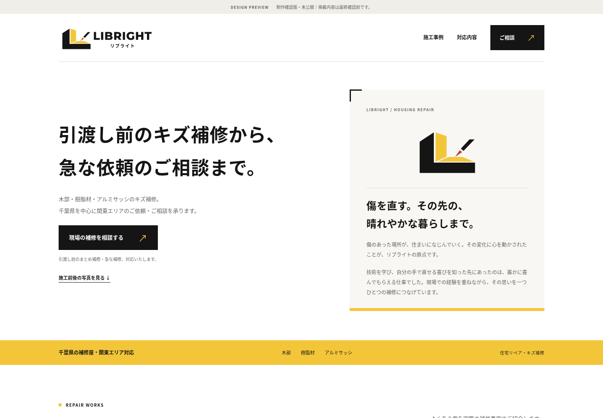
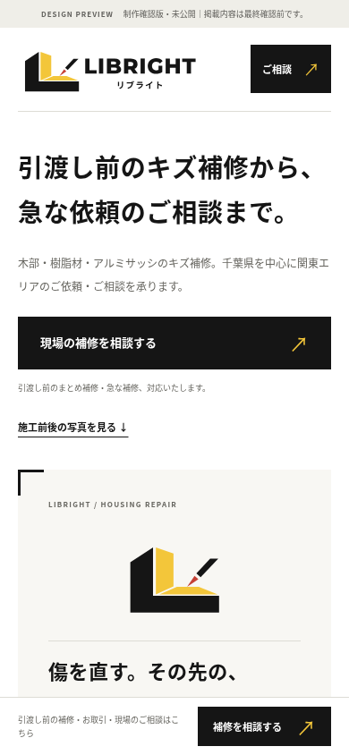

# LIBRIGHT｜正式ロゴに合わせたLPプレビュー

非公開の制作確認版。施工写真3組・計6枚を無加工で配置済みです。料金は未確定のため非表示。

動作する確認版は [HTML](../preview.html) と [写真フォルダ](../assets/cases/) を相対位置を保ってダウンロードしてください。確認用ZIPでは展開後にpreview.htmlを開きます。ロゴはHTML内、写真は元JPEGをそのまま参照します。

## PC

[PC版のページ全体](desktop-full.png)

## スマホ

[スマホ版のページ全体](mobile-full.png)

施工写真の編集・変更は禁止。実写真は元の縦横比と全体を保ち、前後ラベルを写真の外側に置く設計です。

## v0.2：構成・文章の見直し

短い原点の物語と現場で大切にする3項目を追加。全体の文章を法人の現場相談と継続取引を軸に見直しました。

文章のみの確認は[全文一覧](../../docs/COPY_DRAFT.md)、ブラウザで読む場合は[文章確認用HTML](../copy-review.html)をダウンロードしてください。

TRC紹介文案を「現場で大切にすること」の次へ追加しました。現場協力の関係と、TRC自身の補修・技術者育成の事業を分けて紹介。制作確認版のみの表示で、公式リンクはURL確認後に追加します。
